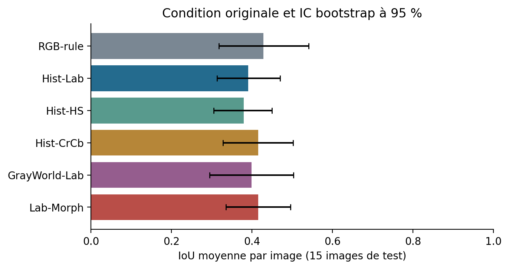
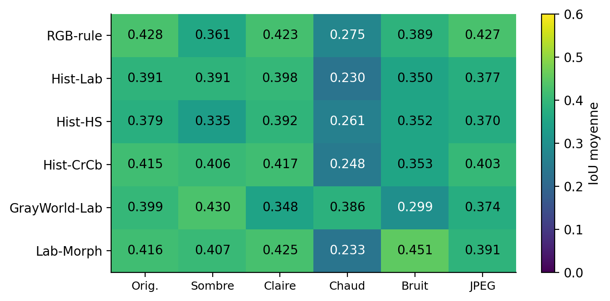
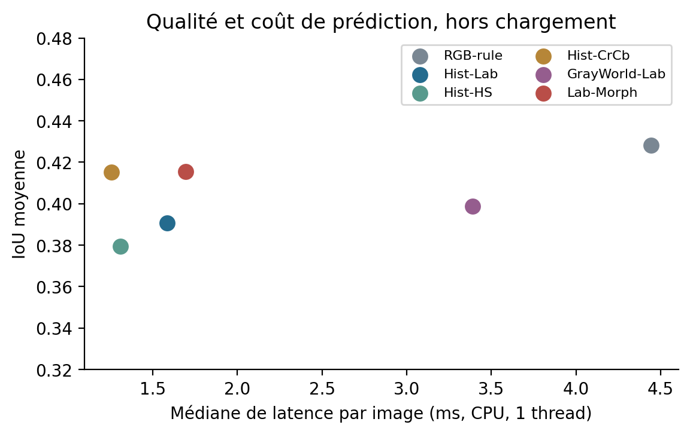

# ChromaVision
### Segmentation couleur classique, robustesse et frugalité

**Python · OpenCV · NumPy · SciPy · Pandas · Matplotlib**

Une chaîne expérimentale complète pour comparer des méthodes de vision
classique sur des photographies annotées : préparation des données,
apprentissage d'histogrammes, choix des seuils, évaluation, analyse des erreurs
et mesure des ressources CPU et mémoire.

**Équipe : Pote Die et Hélène Bobe Douchet**, contribution équivalente.

## Découvrir le projet

- [Résumé pour les recruteurs](docs/Resume_ChromaVision.pdf)
- [Notebook des résultats publics](notebooks/00_Resultats_Publics.ipynb) :
  consultable sans les photographies.
- [Algorithmes](src/chromavision/core.py) : règles RGB, histogrammes conditionnels,
  Gray World, seuillage et morphologie.
- [Notebook de la méthode complète](notebooks/01_Methode_Complete.ipynb) :
  code sans sorties, à exécuter localement après import des données.

## Problème et démarche

**Question :** quel compromis entre recouvrement, résistance aux perturbations
photométriques et coût de calcul offrent des modèles couleur simples ?

1. Contrôler 71 paires image/annotation et leurs empreintes.
2. Séparer les photographies : **42 apprentissage / 14 validation / 15 test**.
3. Comparer six variantes classiques, avec réglages sur la validation originale.
4. Évaluer les mêmes images sous six conditions, soit **540 prédictions**.
5. Analyser IoU, Dice, erreurs, IC bootstrap, temps CPU et mémoire.

La séparation se fait par image entière. Les pixels d'une même photo ne sont
pas répartis entre apprentissage et test. Aucun paramètre n'est choisi sur le test.

## Résultats mesurés

Les valeurs suivantes concernent les **15 images de test originales**.
IoU et Dice sont des moyennes par image. Le temps est la médiane des médianes
sur CPU, un thread OpenCV, hors lecture des fichiers.

| Méthode | IoU moyenne | Dice moyen | Latence (ms/image) |
|---|---:|---:|---:|
| RGB-rule | 0.428 | 0.566 | 4.45 |
| Hist-Lab | 0.391 | 0.543 | 1.59 |
| Hist-HS | 0.379 | 0.534 | 1.31 |
| Hist-CrCb | 0.415 | 0.565 | 1.25 |
| GrayWorld-Lab | 0.399 | 0.541 | 3.39 |
| Lab-Morph | 0.416 | 0.569 | 1.70 |



La règle RGB obtient la plus grande IoU moyenne observée sur le test original.
Les intervalles sont larges : le classement ne justifie pas une supériorité générale.

### Les améliorations dépendent de la perturbation

- **Sous bruit**, Lab-Morph gagne **0,101 d'IoU** sur Hist-Lab,
  IC bootstrap apparié à 95 % **[0,031 ; 0,167]**.
- **Sous dominante chaude**, GrayWorld-Lab gagne **0,156 d'IoU** sur Hist-Lab,
  IC **[0,045 ; 0,270]**.

Ces comparaisons sont exploratoires. Elles utilisent les mêmes photographies
et ne démontrent pas une amélioration dans tous les contextes.



### Frugalité

Les histogrammes finaux stockent une LUT de **4 Kio**. La mémoire de tout le
processus est bien supérieure : environ **110 Mio de RSS** dans l'exécution
livrée. La RSS échantillonnée peut manquer un pic bref et ne mesure pas l'énergie.



## Ce que ce projet met en pratique

- Préparer, contrôler et structurer des données annotées.
- Implémenter des algorithmes et automatiser leurs comparaisons.
- Éviter les fuites entre apprentissage, validation et test.
- Produire des résultats traçables et des analyses statistiques.
- Mesurer les ressources et documenter les limites d'une solution.

## Vérifier les résultats sans télécharger d'images

```bash
python3 -m venv .venv
source .venv/bin/activate
python -m pip install -r requirements.txt
python -m unittest discover -s tests -v
python scripts/verify_results.py
```

Sous Windows, remplacer `python3` par `python` et activer l'environnement avec
`.venv\Scripts\Activate.ps1`. Ouvrir ensuite
`notebooks/00_Resultats_Publics.ipynb` dans VS Code ou Jupyter.

## Refaire l'étude complète avec les données

Les photographies et les masques tiers ne sont pas distribués dans ce dépôt.
Les auteurs du jeu Pratheepan indiquent un usage non commercial. Les sources
et les conditions sont décrites dans [DATA_POLICY.md](DATA_POLICY.md).

Avec l'archive du TP contenant le sous-ensemble exact de 71 paires :

```bash
python scripts/import_lab.py "Lab 1 - files-20261022.zip" --dest .
python scripts/run_experiments.py
python scripts/profile_memory.py
python scripts/audit_data.py
python scripts/make_figures.py
python scripts/verify_results.py --with-data
```

Le manifeste documente le sous-ensemble utilisé. Télécharger une autre version
de Pratheepan ne garantit pas les mêmes 71 fichiers, noms ou octets.

## Organisation

```text
src/chromavision/   Algorithmes
scripts/           Import, expériences, mémoire et vérifications
tests/             Tests sur des exemples contrôlables à la main
notebooks/         Résultats publics et méthode complète
results/           Prédictions, IC, grilles et modèles
docs/              Résumé de présentation sans photographie
```

## Limites

Le test comporte 15 images et une seule séparation principale. Les changements
photométriques sont simulés en RGB encodé. Les identités ne sont pas annotées
et aucune conclusion démographique ou d'équité n'est revendiquée. La couleur
seule manque de contexte sémantique et ces résultats ne démontrent pas un
système prêt pour une utilisation industrielle.

## Références

Tan et al. (2012), Jones et Rehg (2002), Kakumanu et al. (2007), cours de vision
par ordinateur et documentation OpenCV. Voir [REFERENCES.md](REFERENCES.md).
